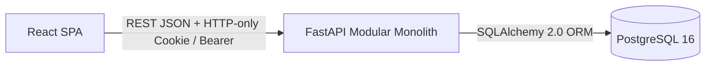
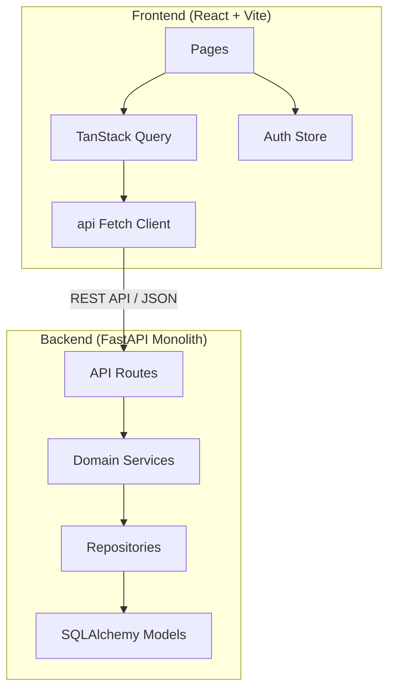
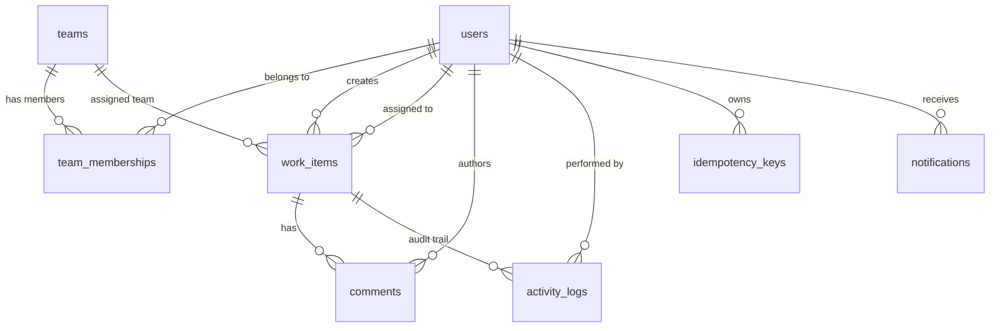
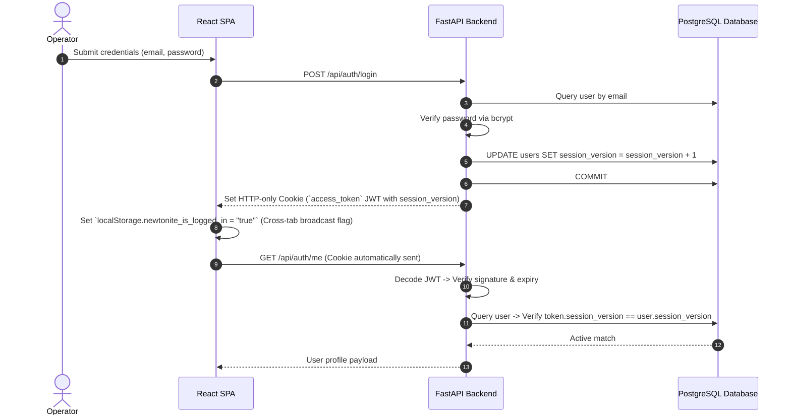
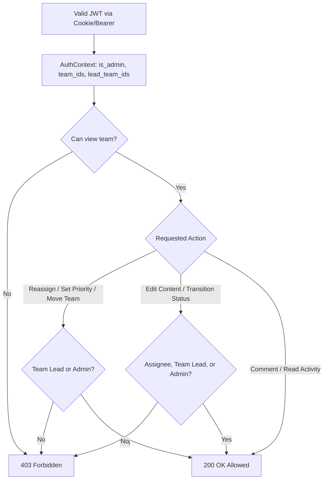
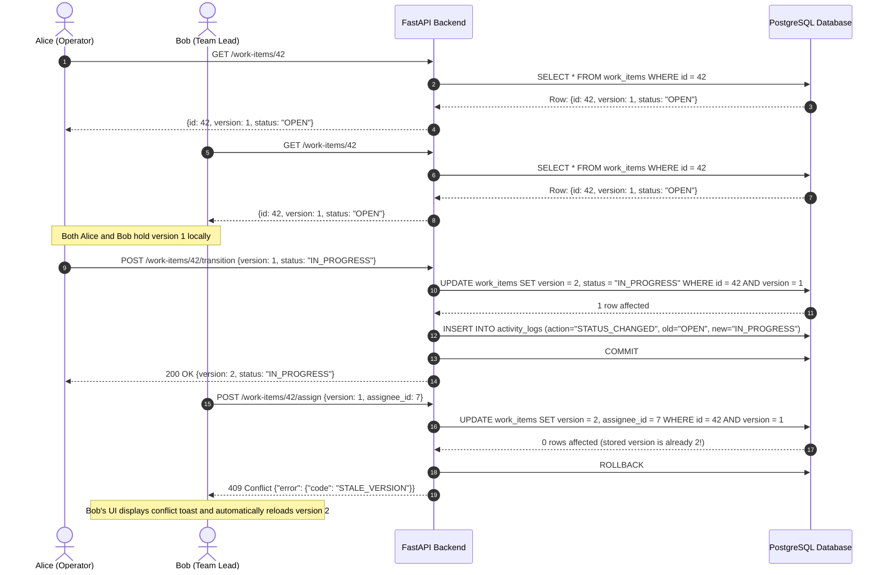
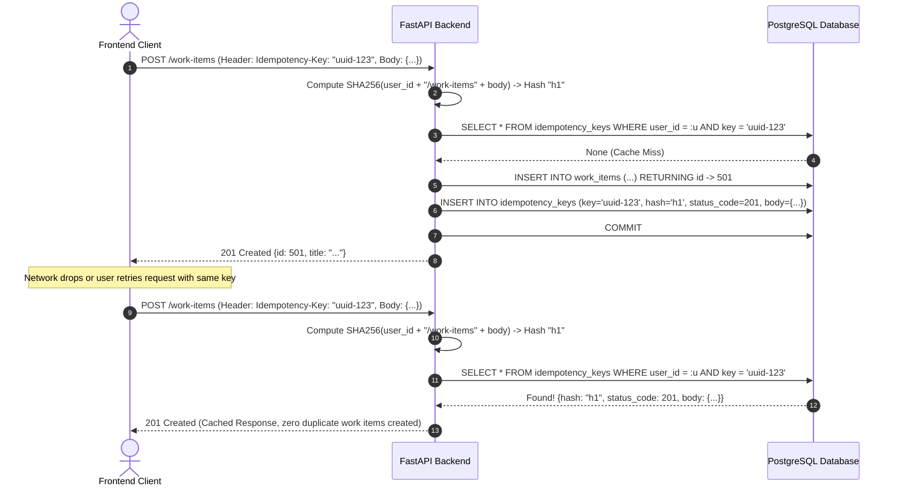

# Newtonite — Architecture & Technical Reference Manual

Newtonite is an operational task coordination platform engineered with strict transactional data integrity, auditability, fine-grained access control, and concurrency safety guarantees.

This document serves as the unified, authoritative architecture and technical reference manual for software engineers, systems evaluators, and academic reviewers.

---

## 1. System Overview & Technology Stack



### Technology Stack
* **Backend**:
  * **Language & Runtime**: Python 3.12
  * **Web Framework**: [FastAPI](https://fastapi.tiangolo.com/) (Asynchronous, OpenAPI 3.1 compliant, dependency injection)
  * **ORM & Database Toolkit**: [SQLAlchemy 2.0](https://www.sqlalchemy.org/) (Typed Declarative mappings, modern 2.0 `select()` syntax)
  * **Relational Database**: [PostgreSQL 16](https://www.postgresql.org/) (ACID transactional guarantees, relational integrity, constraints)
  * **Authentication & Cryptography**: Passlib (Bcrypt hashing), Python-Jose (JWT encoding/decoding with `session_version` claim)
  * **Data Validation**: Pydantic v2 (Request DTOs, response serialization schemas, environment settings)
* **Frontend**:
  * **Framework**: React 19 with TypeScript
  * **Build Tool**: Vite
  * **Client State & Session Cache**: [Zustand](https://zustand-demo.pmnd.rs/) with cross-tab `StorageEvent` synchronization
  * **Server State & Caching**: [TanStack Query v5](https://tanstack.com/query/latest) (Automatic background refetching, optimistic cache invalidation)
  * **Styling**: Tailwind CSS & Lucide Icons
  * **User Notifications & Feedback**: Sonner toast notifications
* **Containerization & Deployment**:
  * Docker Compose (`backend` on port 8000, `frontend` on port 8080, `postgres` on port 5432)

---

## 2. Component Relationships & Layered Architecture



The backend follows a clean, modular architecture with shallow, well-defined layers:

| Layer | Path | Core Responsibility |
| :--- | :--- | :--- |
| **Routes** | `backend/app/api/routes/` | HTTP request handling, route parameters, status codes, dependency injection. |
| **Schemas** | `backend/app/schemas/` | Pydantic contracts for input validation and output serialization. |
| **Services** | `backend/app/services/` | Business workflow logic, authorization scoping, concurrency checks, idempotency, audit trail. |
| **Repositories** | `backend/app/repositories/` | Database query composition, eager joins, sorting, pagination, and persistence. |
| **Models** | `backend/app/models/` | SQLAlchemy declarative mappings, database constraints, enums, state machine definitions. |
| **Core** | `backend/app/core/` | Configuration, database engine, JWT cryptography, password hashing, and error envelopes. |

---

## 3. Source Code Directory Map

### Backend Tree (`backend/app/`)
```
backend/app/
├── api/
│   ├── deps.py               # Dependency injection: user auth, AuthContext, idempotency header
│   └── routes/
│       ├── auth.py           # Login, registration, logout, profile update endpoints
│       ├── dashboard.py      # Aggregated metrics and team workload endpoints
│       ├── notifications.py  # User notifications inbox, unread counts, mark-as-read
│       ├── users.py          # Administrative user verification and employee management
│       └── work_items.py     # CRUD, transitions, assignments, comments, audit history
├── core/
│   ├── config.py             # Pydantic BaseSettings loading .env configuration
│   ├── database.py           # SQLAlchemy engine, session factory, request session lifecycle
│   ├── errors.py             # Custom AppError and standardized HTTP error envelope
│   └── security.py           # Bcrypt password hashing, JWT creation and decoding
├── models/
│   └── __init__.py           # SQLAlchemy ORM entities, enums, FSM ALLOWED_TRANSITIONS
├── repositories/
│   └── __init__.py           # Data access repository layer (User, WorkItem, Activity, etc.)
├── schemas/
│   └── __init__.py           # Pydantic input DTOs and response schemas
├── services/
│   ├── authz.py              # Resource-level authorization and team visibility scoping
│   ├── dashboard.py          # Server-side single-query aggregations
│   ├── idempotency.py        # SHA-256 payload hashing and duplicate mutation gating
│   ├── notifications.py      # Event-driven in-app notification dispatching
│   └── work_items.py         # Domain logic: OCC version checks, state machine, audit logs
├── main.py                   # FastAPI initialization, CORS, global exception handlers
└── seed.py                   # Idempotent demo database seeding script
```

### Frontend Tree (`frontend/src/`)
```
frontend/src/
├── api/
│   ├── client.ts             # Fetch client wrapper with 401 logout & 409 conflict normalization
│   └── notifications.ts      # Typed notification endpoints
├── components/
│   ├── dashboard/            # Data visualization widgets (Donut, Priority, Workload charts)
│   ├── notifications/
│   │   └── NotificationBell.tsx # Header notification popover bell and badge counter
│   └── ui/                   # Reusable atomic UI components (Button, Card, Dialog, Input, etc.)
├── hooks/
│   ├── use-api.ts            # React Query hooks for WorkItems, Users, Teams, Dashboard
│   └── use-notifications.ts  # React Query hooks for notification polling & mutations
├── layouts/
│   └── AppLayout.tsx         # Main application shell with sidebar and header
├── pages/
│   ├── index.ts              # Central pages barrel export
│   ├── AdminEmployeeManagementPage.tsx # Admin employee auditing and account removal
│   ├── AdminUsersPage.tsx    # Admin user registration approval / rejection
│   ├── DashboardPage.tsx     # KPI metrics and workload distribution charts
│   ├── LoginPage.tsx         # Dual-mode sign in and registration portal
│   ├── NewWorkItemPage.tsx   # Idempotent task creation form with team assignee filtering
│   ├── NotificationsPage.tsx # Full notification inbox with search and filters
│   ├── ProfilePage.tsx       # Operator profile and team membership editor
│   ├── WorkItemDetailPage.tsx# OCC mutation workspace, state transitions, audit trail
│   └── WorkItemListPage.tsx  # Filterable, paginated task ledger with URL sync
├── routes/
│   └── ProtectedRoute.tsx    # Authentication guard checking local and server session
├── store/
│   └── auth.ts               # Zustand store with cross-tab localStorage broadcast
├── types/
│   └── index.ts              # TypeScript domain types mirroring backend Pydantic schemas
└── App.tsx                   # Route tree and cross-tab logout listener
```

---

## 4. Database Schema & Relational Design



### Table Specifications
* **`users`**: Unique email, hashed password (`bcrypt`), `is_admin` boolean flag, `is_approved` status, and `session_version` integer used for session revocation.
* **`teams`**: Organizational operational teams (e.g. Engineering, Support, Operations, Compliance).
* **`team_memberships`**: Join table binding `user_id` and `team_id` with an explicit `role` enum (`MEMBER` or `TEAM_LEAD`).
* **`work_items`**: Core domain entity with title, description, `type`, `priority`, `status`, foreign keys to `team_id`, `created_by_id`, `assignee_id`, timestamp columns (`created_at`, `updated_at`, `due_at`, `resolved_at`), `blocked_reason`, and the integer `version` column used for Optimistic Concurrency Control.
* **`comments`**: Threaded operational discussion messages referencing `work_item_id` and `author_id`.
* **`activity_logs`**: Immutable, append-only audit trail capturing `work_item_id`, `actor_id`, `action`, `old_value`, and `new_value`.
* **`idempotency_keys`**: Idempotent mutation store recording `(user_id, key)` unique pairs, `request_hash` (SHA-256), `status_code`, and cached response body.
* **`notifications`**: Targeted user alert items with `type` category, title, message, destination link, and `is_read` boolean flag.

---

## 5. Architectural Lifecycle Protocols

### 5.1. Authentication & Session Invalidation Protocol


#### Note on HTTP-only Cookies vs. `localStorage` Sentinel:
* **Credential Storage**: Sensitive JWT credentials are kept exclusively inside secure HTTP-only cookies (`HttpOnly, SameSite=Lax`). Client scripts have no access to the token, preventing XSS token exfiltration.
* **Cross-Tab Synchronization**: Because browsers do not fire events when an HTTP-only cookie is cleared in another window/tab, client scripts cannot observe cookie changes directly.
* **The Sentinel Solution**: A non-sensitive flag (`localStorage.newtonite_is_logged_in`) containing no credentials or user data is used solely as an event signal. When any tab logs out, removing this key triggers the browser's native `window.addEventListener("storage", ...)` event across all other open tabs of the same origin, immediately synchronizing the logged-out state.

---

### 5.2. Fine-Grained Authorization Scoping Protocol


* **`AuthContext`**: Caches the authenticated operator's permissions once per request:
  * `is_admin`: Global platform administrators can access all teams and administrative functions.
  * `team_ids`: Set of team IDs the user is a member of. Users can only view work items belonging to their teams.
  * `lead_team_ids`: Set of team IDs where the user holds the `TEAM_LEAD` role.
* **Field-Level Guards**: Reassigning work items or changing priorities requires Team Lead or Admin status to prevent unauthorized task offloading.

---

### 5.3. Optimistic Concurrency Control (OCC) Protocol


* **Atomic Database Update**: The mutation query requires `WHERE id = :id AND version = :expected_version`.
* **Zero Silent Overwrites**: If another user updated the record, 0 rows are affected and a typed `409 STALE_VERSION` error is returned.
* **Client-Side Stale Detection**: The frontend polls work item status every 8 seconds. If `server.version > local.version`, an alert banner prompts the user to refresh before submitting conflicting edits.

---

### 5.4. Idempotency Key Replay Protocol


* **Deterministic Payload Hashing**: The request payload is hashed with SHA-256. If the same key is sent with different body parameters, a `409 IDEMPOTENCY_KEY_REUSED` error is raised.
* **Race Condition Protection**: A PostgreSQL unique index on `(user_id, key)` guarantees that concurrent requests catch an `IntegrityError` and replay the winner's result safely.

---

### 5.5. Finite State Machine (FSM) Lifecycle
Work items progress through defined operational phases:
```
  [OPEN] ──────> [IN_PROGRESS] ──────> [PENDING_APPROVAL] ──────> [RESOLVED] ──────> [CLOSED]
     │                 │                       │                     │
     │                 ▼                       │                     ▼
     │            [BLOCKED] ───────────────────┘               [IN_PROGRESS]
     │                 │
     ▼                 ▼
  [CLOSED]        [IN_PROGRESS]
```
* **Validation**: Attempting an undeclared transition raises a `400 INVALID_TRANSITION` error.
* **Blocker Requirement**: Transitioning to `BLOCKED` requires an explicit `blocked_reason`.
* **Resolution Stamping**: Transitioning to `RESOLVED` automatically stamps `resolved_at = datetime.now(timezone.utc)`.

---

### 5.6. Co-Transactional Audit Logging
* **Atomic Consistency**: Every status update, reassignment, priority shift, and blocker update inserts an `activity_logs` entry in the **exact same transaction** as the work item change.
* **Immutability**: No public API route exists to modify or delete activity logs. Normal users cannot tamper with audit history.

---

## 6. Testing & Quality Assurance Architecture

### 6.1. Backend Pytest Suite (`backend/tests/`)
* **Total Automated Tests**: 29 test cases.
* **Modules Covered**:
  * `test_auth.py`: User registration, approval verification, password hashing, session version invalidation, login/logout cookies.
  * `test_work_items.py`: Full CRUD operations, FSM transition legality, illegal transition rejection, OCC concurrency collision verification (`409 STALE_VERSION`).
  * `test_idempotency.py`: SHA-256 payload matching, replay of identical payloads, rejection of key reuse with altered payloads (`409 IDEMPOTENCY_KEY_REUSED`).
  * `test_authorization.py`: Team visibility scoping, role-based reassignment restrictions, Team Lead privilege elevation.
  * `test_notifications.py`: Triggering notifications on assignment, status transitions, approval requests, unread count polling, and mark-as-read status updates.
* **Run Command**:
  ```bash
  docker compose exec backend pytest
  ```

### 6.2. Frontend Vitest Suite (`frontend/src/`)
* **Total Automated Tests**: 15 unit and integration tests.
* **Modules Covered**:
  * API client error parsing, status mapping, and 401 unauthorization interception.
  * Auth store state management and localStorage sync.
  * Notification badge counter, icon rendering, and filtering logic.
  * Form validation schemas (Zod).
* **Run Command**:
  ```bash
  npm test -- --run
  ```

---

## 7. Developer & Maintenance Guidelines

1. **Adding a New Work Item Status**:
   - Add status value to `WorkItemStatus` enum in [`backend/app/models/__init__.py`](file:///c:/Users/Suraj%20Kumar%20Saw/Documents/B.Tech%20-%20CSE/newtonite/backend/app/models/__init__.py).
   - Update `ALLOWED_TRANSITIONS` graph in the same file.
   - Update client mirror `TRANSITIONS` in [`frontend/src/pages/WorkItemDetailPage.tsx`](file:///c:/Users/Suraj%20Kumar%20Saw/Documents/B.Tech%20-%20CSE/newtonite/frontend/src/pages/WorkItemDetailPage.tsx).
2. **Adding a New Audit Action**:
   - Add action string to `ActivityAction` enum in [`backend/app/models/__init__.py`](file:///c:/Users/Suraj%20Kumar%20Saw/Documents/B.Tech%20-%20CSE/newtonite/backend/app/models/__init__.py).
   - Dispatch `ActivityLog` inside the relevant method in [`backend/app/services/work_items.py`](file:///c:/Users/Suraj%20Kumar%20Saw/Documents/B.Tech%20-%20CSE/newtonite/backend/app/services/work_items.py) ensuring it participates in the active transaction before commit.
3. **Database Seeding**:
   - Re-populate demo data at any time using `docker compose exec backend python -m app.seed`.
